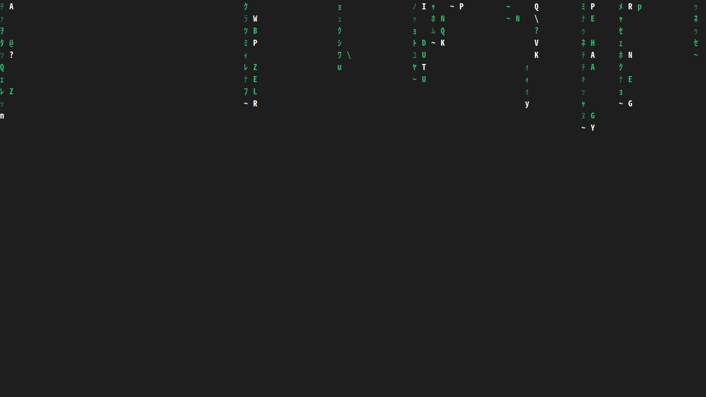

# matrix-saver

The Matrix digital rain as a real screensaver. It runs
[cmatrix](https://github.com/abishekvashok/cmatrix) as an
[XScreenSaver](https://www.jwz.org/xscreensaver/) hack, with katakana glyphs
and a dark theme that fits Ubuntu.



- Fills every monitor exactly. The xterm measures its font and resizes to fit,
  so it works at any DPI, font size or resolution.
- Shows up in `xscreensaver-settings` with speed, font size, charset and bold
  options.
- Colours, font and extra cmatrix flags go in one config file.
- One POSIX shell script. Nothing to compile.

## Requirements

- An **X11** session (see [Wayland](#wayland))
- `xscreensaver` 6.x, `cmatrix` 2.x, `xterm`, `xwininfo`
- A CJK font for katakana (falls back to ASCII if it's missing)

| Distro | Command |
|---|---|
| Debian / Ubuntu / Mint | `sudo apt install xscreensaver cmatrix xterm x11-utils fonts-noto-cjk` |
| Fedora | `sudo dnf install xscreensaver cmatrix xterm xwininfo google-noto-sans-cjk-fonts` |
| Arch | `sudo pacman -S xscreensaver cmatrix xterm xorg-xwininfo noto-fonts-cjk` |
| openSUSE | `sudo zypper install xscreensaver cmatrix xterm xwininfo noto-sans-cjk-fonts` |

On Ubuntu and other GNOME desktops, turn off GNOME's own screen blanking and
lock (Settings → Power / Privacy) and add xscreensaver to your startup apps.

## Install

**Just for you (no root needed):**

```sh
git clone https://github.com/wjr-timmers/cmatrix-screensaver.git
cd cmatrix-screensaver
./install.sh --activate     # drop --activate to only add it to the list
```

This copies the script to `~/.local/bin` and writes a default config to
`~/.config/matrix-saver/config`. It also adds the screensaver to the top of
`~/.xscreensaver`, after saving a backup of that file. `./install.sh --uninstall`
reverses this.

**System-wide** (this also installs the settings panel for
`xscreensaver-settings`):

```sh
sudo make install PREFIX=/usr
```

Then add `matrix-saver` to the programs list in `xscreensaver-settings`.

## Try it

```sh
matrix-saver -window        # in a window
matrix-saver -fullscreen    # fullscreen; any key quits
matrix-saver --tty          # in the terminal you're in
xscreensaver-command -activate
```

## Configure

Edit `~/.config/matrix-saver/config`
(see [`matrix-saver.conf.example`](matrix-saver.conf.example)):

```sh
FONT="Noto Sans Mono CJK JP"
FONT_SIZE=11
BG="#1E1E1E"
COLOR_DIM="#26A269"
COLOR_BRIGHT="#2DBE6C"
COLOR_HEAD="#FFFFFF"
CHARSET=japanese      # or ascii
SPEED=6               # 0 fast .. 10 slow
BOLD=yes              # yes | no | all
CMATRIX_ARGS=""       # e.g. "-a -k" or "-r" for rainbow
```

Settings are applied in this order, with later ones winning: the config file,
then `MATRIX_*` environment variables (`MATRIX_SPEED=2 matrix-saver -window`),
then command-line flags (`-speed`, `-font`, `-font-size`, `-bold`, `-ascii`).
The xscreensaver settings panel uses the command-line flags.

Want the lock dialog to match? See [`extras/`](extras/README.md).

## How it works

XScreenSaver gives every hack an X window (`$XSCREENSAVER_WINDOW`).
`matrix-saver` starts an `xterm -into` that window, oversized so nothing
flashes. A second copy of the script runs inside the xterm. It asks xterm for
its cell size (`CSI 16 t`) and resizes the terminal so it covers the window,
rounding up (`CSI 8 ; rows ; cols t`). Then it `exec`s cmatrix. Only those two
xterm window operations are enabled; the rest stay at xterm's locked-down
defaults.

## Wayland

XScreenSaver can't run as a screensaver under Wayland: Wayland compositors
don't let other programs take over the screen or watch for idle input. On
Ubuntu, choose **Ubuntu on Xorg** from the gear icon on the login screen.
Native Wayland support is on the roadmap.

## Roadmap

- [x] Linux / X11 via XScreenSaver
- [ ] Packages: AUR, `.deb` / PPA, Fedora COPR, Nix
- [ ] Wayland: idle hook for sway / Hyprland (`swayidle`, `hypridle`) and KDE
- [ ] Native renderer (no xterm / cmatrix dependency), which is needed for:
- [ ] macOS `.saver` bundle
- [ ] Windows `.scr`

## Credits

The rain itself is [cmatrix](https://github.com/abishekvashok/cmatrix)
by Chris Allegretta and Abishek V Ashok (GPL-3.0). matrix-saver only runs it
and does not include its code.

## License

[MIT](LICENSE)
